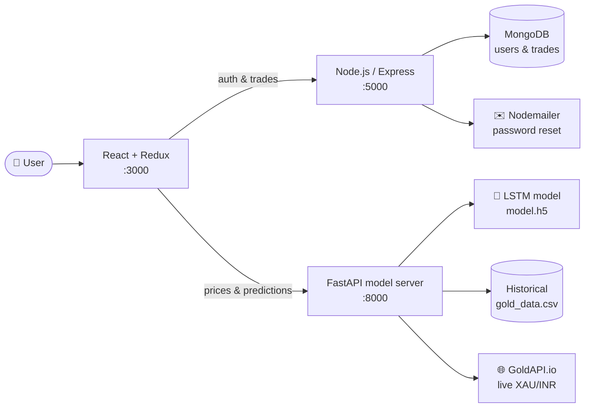
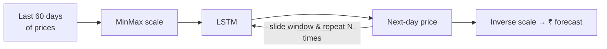

<div align="center">

# 🪙 TradyGold

**A digital-gold trading platform with live INR gold prices, buy/sell in grams, a portfolio dashboard — and an LSTM deep-learning model that forecasts future gold prices.**


[Features](#-features) · [Architecture](#%EF%B8%8F-architecture) · [ML Model](#-the-price-prediction-model) · [Getting Started](#-getting-started) · [API](#-api-reference)

</div>

---

## ✨ Features

| | Feature | Details |
|---|---|---|
| 📈 | **Live gold price** | Real-time XAU → INR price from GoldAPI, converted to price per gram |
| 🔮 | **Price forecast** | Predict the next *N* days of gold prices with a trained LSTM model |
| 📊 | **Historical charts** | Explore past prices for any date range (Chart.js / Recharts) |
| 🛒 | **Buy & sell gold** | Trade in grams, with a gold calculator and a mock payment gateway (success / failure flows) |
| 💼 | **Portfolio dashboard** | Holdings, trade history and analysis tabs |
| 🔐 | **Auth** | Sign up / sign in with JWT, forgot & reset password via email (Nodemailer) |
| 🗞️ | **Landing page** | Hero, features, how-it-works, testimonials and a live gold-news ticker (newsdata.io) |
| 💾 | **Persistent state** | Redux Toolkit slices persisted with `redux-persist` |

## 🏗️ Architecture

TradyGold is made of **three services** that run side by side:



## 🧠 The Price Prediction Model

<details>
<summary><b>How the forecast works</b></summary>

<br/>

1. Historical daily gold prices (`model_server/model/gold_data.csv`) are scaled with a `MinMaxScaler`.
2. An **LSTM** network (built and analysed in [`gold_model_analytics.ipynb`](model_server/model/gold_model_analytics.ipynb)) is trained on sliding windows of **60 days** and saved as `model.h5`.
3. For a request of *N* days, the server feeds the last 60 days in, predicts one day, appends that prediction to the window, and repeats — an autoregressive multi-step forecast.



</details>

## 🚀 Getting Started

### Prerequisites

- Node.js 18+ and npm
- Python 3.9+
- A MongoDB connection string
- A free API key from [GoldAPI.io](https://www.goldapi.io/)

<details open>
<summary><b>1️⃣ Frontend (repo root)</b></summary>

```bash
npm install
npm start            # http://localhost:3000
```

</details>

<details open>
<summary><b>2️⃣ Backend — auth & trades (<code>server/</code>)</b></summary>

```bash
cd server
npm install
cp .env.example .env # fill in the values below
npm start            # or: npm run dev (nodemon) → http://localhost:5000
```

</details>

<details open>
<summary><b>3️⃣ Model server — prices & predictions (<code>model_server/</code>)</b></summary>

```bash
cd model_server
python -m venv myenv
source myenv/bin/activate          # Windows: myenv\Scripts\activate
pip install -r requirements.txt
cp .env.example .env               # add GOLD_API_KEY
uvicorn main:app --reload          # http://127.0.0.1:8000
```

> If `uvicorn` isn't found on your PATH, run `python -m uvicorn main:app --reload`.

</details>

<details>
<summary><b>⚙️ Environment variables</b></summary>

**`server/.env`**

| Variable | Description |
|---|---|
| `PORT` | API port (default `5000`) |
| `MONGO_URI` | MongoDB connection string |
| `JWT_SECRET` | Secret for signing tokens |
| `MAIL_HOST` / `MAIL_USER` / `MAIL_PASS` | SMTP settings for password-reset emails |

**`model_server/.env`**

| Variable | Description |
|---|---|
| `GOLD_API_KEY` | GoldAPI.io access token for live prices |

</details>

## 📡 API Reference

<details>
<summary><b>Node.js API — <code>http://localhost:5000</code></b></summary>

| Method | Endpoint | Auth | Description |
|---|---|---|---|
| `POST` | `/api/auth/signup` | – | Create an account |
| `POST` | `/api/auth/signin` | – | Log in, returns JWT |
| `POST` | `/api/auth/forgot-password` | – | Email a reset link |
| `POST` | `/api/auth/reset-password` | – | Set a new password |
| `GET` | `/api/trade/profile` | ✅ | User's holdings & trade history |
| `POST` | `/api/trade/buy` | – | Buy gold |
| `POST` | `/api/trade/sell` | ✅ | Sell gold |

</details>

<details>
<summary><b>Model server — <code>http://127.0.0.1:8000</code></b></summary>

| Method | Endpoint | Description |
|---|---|---|
| `GET` | `/api/live-prices/` | Live XAU/INR price from GoldAPI |
| `GET` | `/api/predict/?num_days=7` | LSTM forecast for the next *N* days |
| `GET` | `/api/gold-prices/?start_date=YYYY-MM-DD&end_date=YYYY-MM-DD` | Historical prices for a range |
| `GET` | `/docs` | Swagger UI |

</details>

## 📁 Project Structure

<details>
<summary><b>Expand tree</b></summary>

```text
TradyGold/
├── src/                       # React frontend
│   ├── components/            # Navbar, Sidebar, charts, tables, landing sections
│   ├── pages/                 # Landing, Home, Dashboard, Buy, Sell, Analysis, Auth, Payment_Gateway
│   ├── store/slices/          # auth, gold, trade, user, settings
│   └── utils/api.js           # calls to the model server
├── server/                    # Node.js + Express + MongoDB
│   ├── controllers/  models/  routes/  middleware/
│   └── server.js
└── model_server/              # FastAPI + Keras
    ├── model/                 # gold_model.py, model.h5, gold_data.csv, notebook
    ├── routes/                # prediction, prices, gold_prices
    └── main.py
```

</details>

---

<div align="center">

Built by **[Shariq](https://github.com/Shariq2003)** · [LinkedIn](https://www.linkedin.com/in/shariq-sd)

⭐ If you like this project, consider giving it a star!

</div>
